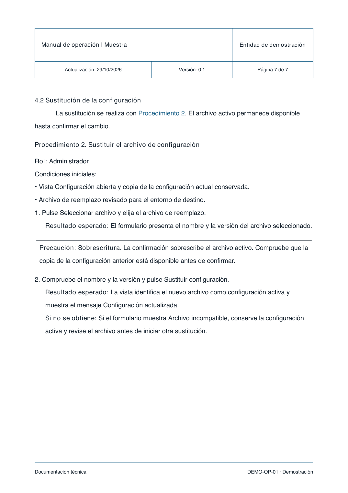

# Informe técnico institucional

Skill para crear informes técnicos, manuales de sistemas y catálogos de datos a partir de código, documentación, capturas y otras fuentes del sistema. La entidad, el logo y los colores se configuran para cada proyecto.

**Versión 0.4.0.** Incluye procedimientos con resultados esperados, avisos opcionales, criterios APA 7, mejoras de redacción y alineación del pie. Mantiene compatibilidad con las fuentes anteriores.



[Ver esta muestra en PDF](docs/muestra-procedimientos-avisos.pdf) · [Fuente editable](skills/informe-tecnico/assets/ejemplo-procedimientos.json) · [Leer la skill](skills/informe-tecnico/SKILL.md) · [Plantilla base](skills/informe-tecnico/assets/plantilla-base.json)

La vista previa se generó con el motor 0.4.0. La versión que aparece en su cabecera corresponde al documento de demostración, independiente de la versión de la skill.

## Ejemplos disponibles

| Muestra | Qué permite revisar | PDF y fuente |
| --- | --- | --- |
| Procedimientos y avisos | Perfil APA, pasos con resultados esperados, notas y precauciones, índice de procedimientos y pie alineado. | [PDF actual](docs/muestra-procedimientos-avisos.pdf) · [JSON](skills/informe-tecnico/assets/ejemplo-procedimientos.json) |
| Formato con criterios APA 7 | Sangrías, interlineado, cursivas, referencias y presentación de tablas y figuras. | [PDF](docs/muestra-perfil-apa.pdf) · [JSON](skills/informe-tecnico/assets/ejemplo-apa.json) |
| Perfil institucional original | Composición anterior y ejemplo de integración con diagram-design. Se conserva para comparar perfiles. | [PDF](docs/muestra-informe-tecnico.pdf) · [JSON](skills/informe-tecnico/assets/ejemplo.json) |

## Qué resuelve

- Entidad, logo, colores, líneas y marco configurables.
- Cabecera con fecha de actualización, versión y «Página X de Y»; entidad y paginación comparten el mismo separador vertical.
- Historial de cambios con identificadores estables y referencias enlazadas.
- Contenido e índices de tablas, figuras y procedimientos calculados al compilar.
- Tablas multipágina con títulos y encabezados repetidos.
- Figuras con fuente editable, número, pie y destino en el índice.
- Comprobación estructural del PDF y pruebas de regresión del motor.
- Redacción de presentación adaptada a informes y manuales, con referencias por nombre o código documental. Las rutas personales y la trazabilidad de autoría quedan en archivos de trabajo.
- Perfil institucional con criterios APA 7: interlineado doble, sangría inicial, referencias con sangría francesa, cursivas y presentación de tablas y figuras.
- Procedimientos opcionales con acción y resultado esperado por paso, índice propio y avisos de nota, precaución o advertencia. [Criterios de uso](skills/informe-tecnico/references/procedimientos.md) y [ejemplo editable](skills/informe-tecnico/assets/ejemplo-procedimientos.json).

La muestra es ficticia. Los documentos institucionales que orientaron el diseño se describen en [fuentes](skills/informe-tecnico/references/fuentes.md); sus PDF y logos originales no forman parte del repositorio.

## Instalar en Codex

Pide al agente:

> Instala la skill informe-tecnico desde https://github.com/andresalmeida/informe-tecnico, ruta skills/informe-tecnico.

Para crear esquemas nuevos, añade la colaboradora:

> Instala diagram-design desde https://github.com/cathrynlavery/diagram-design, ruta skills/diagram-design.

El instalador de skills de Codex también admite estos comandos, ejecutados en un entorno con Python y acceso a GitHub:

```sh
python3 "${CODEX_HOME:-$HOME/.codex}/skills/.system/skill-installer/scripts/install-skill-from-github.py" \
  --repo andresalmeida/informe-tecnico --path skills/informe-tecnico

# Opcional, para crear esquemas nuevos:
python3 "${CODEX_HOME:-$HOME/.codex}/skills/.system/skill-installer/scripts/install-skill-from-github.py" \
  --repo cathrynlavery/diagram-design --path skills/diagram-design
```

Las skills instaladas estarán disponibles en el siguiente turno de Codex. Si ya existe una instalación, revisa las diferencias antes de actualizarla.

## Uso

Para un informe:

```text
Usa $informe-tecnico para preparar un informe sobre [tema] a partir de mis
archivos. Usa la identidad de [entidad] y coloca el trabajo principal en el
capítulo 4. Para los esquemas necesarios, aplica $diagram-design con los
mismos colores y tipografía.
```

Para un manual de un sistema:

```text
Usa $informe-tecnico para crear un manual de usuario por roles a partir de
este código, los manuales y las capturas. Incluye navegación y procedimientos
con resultados esperados. Usa la identidad de [entidad] y pide los datos
esenciales que falten para describir el funcionamiento real.
```

La entrega incluye PDF, fuente JSON editable y los activos necesarios para regenerarlo. El motor incluido produce PDF; para un DOCX se utiliza el flujo específico de Word. La información disponible determina el alcance: no se inventan permisos, funciones ni resultados de validación.

La estructura base comprende preliminares y siete capítulos:

1. Introducción.
2. Objetivos.
3. Alcance.
4. **Desarrollo técnico:** el trabajo principal, dividido en 4.1, 4.2, etc.
5. Resultados.
6. Conclusiones y recomendaciones.
7. Referencias.

Los módulos se adaptan al tipo de documento y a las estructuras institucionales que deban preservarse. Consulta la [guía de estructura](skills/informe-tecnico/references/estructura.md).

La [guía de redacción](skills/informe-tecnico/references/redaccion.md) distingue un informe de actividad, un manual y una evaluación solicitada. El documento describe el sistema y el trabajo realizado con lenguaje técnico; no narra cómo lo investigó el agente. Las comprobaciones y los pendientes conservan su estado real.

En resultados, conclusiones o resúmenes solicitados se presenta primero la respuesta sustentada y después sus razones y evidencia. La revisión editorial elimina repeticiones de relleno y conserva los términos técnicos, las listas útiles y las repeticiones necesarias para consultar una tarea por separado. Son criterios incorporados a la guía; Minto y unicorntext no se requieren como skills adicionales.

## Formato con criterios APA 7

Los documentos nuevos parten de `format.profile: "institucional-apa"`: cuerpo de 11 pt, interlineado 2,0, sangría inicial de 1,27 cm y referencias con sangría francesa de 1,27 cm. Los títulos de tabla/figura se colocan encima, con número en negrita y título en cursiva. Las tablas usan líneas horizontales mínimas y celdas con interlineado sencillo.

Se conservan identidad, cabecera, portada, índices, márgenes institucionales y capítulos numerados. Es una adaptación para informes, no un formato académico APA integral. La [guía APA](skills/informe-tecnico/references/apa.md) identifica las diferencias y la atribución autor-fecha. Las fuentes antiguas sin `format` mantienen su composición; `profile: "institucional"` permite elegir expresamente el perfil original.

Los bloques `reference` y `quotation`, y los tramos `runs` para cursivas/negritas, están descritos en el [contrato](skills/informe-tecnico/references/contrato.md). El motor compone las entradas que se le suministran; la selección y verificación de autores, fechas y citas siguen siendo trabajo de autoría. La [guía APA](skills/informe-tecnico/references/apa.md) reúne los criterios y sus fuentes oficiales.

## Una skill coordina la otra

`informe-tecnico` y `diagram-design` se instalan por separado. El agente que aplica la principal carga la colaboradora cuando necesita crear un esquema:

| Paso | Responsable | Resultado |
| --- | --- | --- |
| Definir qué explicar y con qué evidencia | informe-tecnico | Propósito, datos, identidad y escala de impresión |
| Elegir representación y componer el esquema | diagram-design | HTML con SVG, validación y exportación estática |
| Integrar y comprobar el documento | informe-tecnico | Figura numerada, pie, referencias, índice y PDF revisado |

La integración es una instrucción de composición para el agente. El script `build_report.py` incorpora archivos terminados; no ejecuta otra skill ni instala dependencias automáticamente. La [guía de diagramas](skills/informe-tecnico/references/diagramas.md) define el flujo completo.

Para un informe que ya dispone de sus figuras, o que solo necesita texto y tablas, el motor PDF funciona sin diagram-design. Al cambiar de identidad gráfica, también se regeneran los esquemas externos desde su fuente editable.

## Ejecutar el motor sin el agente

Requiere Python 3.10 o posterior. Desde la raíz del repositorio:

```sh
python3 -m venv .venv
source .venv/bin/activate
python -m pip install -r requirements.txt

python skills/informe-tecnico/scripts/build_report.py \
  skills/informe-tecnico/assets/ejemplo-procedimientos.json \
  --output output/muestra.pdf

python skills/informe-tecnico/scripts/check_report.py output/muestra.pdf
python skills/informe-tecnico/scripts/self_test.py
```

El motor genera el PDF y un manifiesto de compilación. Para crear un informe propio, copia `plantilla-base.json`, completa la identidad, los metadatos, el historial y el contenido, y conserva los activos junto a la fuente. Los campos obligatorios vacíos deben completarse antes de compilar.

El ejemplo anterior compila un manual ficticio con procedimientos y avisos. La muestra del perfil original incluye además un esquema exportado a PNG y sus fuentes HTML/SVG editables. Integrar otros SVG directamente requiere el paquete opcional `svglib` y revisión de su compatibilidad. Crear o regenerar esquemas con diagram-design usa sus herramientas y requisitos propios.

## Comprobaciones y límites

Las pruebas comprueban continuación de tablas, desplazamiento de destinos al crecer el índice, conservación de números de catálogo, ceros iniciales, otro perfil gráfico/papel y rechazo de referencias desconocidas, IDs duplicados, filas excesivas y cabeceras desalineadas.

La regresión APA mide en el PDF la sangría de 36 pt y la distancia de 22 pt entre líneas, la sangría francesa y el bloque de cita, además de cursivas, título sobre la imagen y continuación de tablas. No certifica cumplimiento APA integral ni exactitud de las referencias.

Las pruebas de procedimientos comprueban navegación, continuidad entre páginas, posición del aviso antes de la acción y rechazo de pasos sin resultado esperado. Los avisos y resultados esperados no registran una ejecución de la aplicación ni una aprobación.

El motor incluido produce PDF A4/Carta en vertical. El contenido se mantiene en JSON editable; no genera DOCX. Las comprobaciones automáticas no verifican los hechos técnicos, las aprobaciones institucionales ni la conformidad PDF/UA. La entrega requiere abrir las páginas renderizadas y revisar su composición.

## Licencia y atribuciones

[MIT](LICENSE). El scaffold del ejemplo de diagrama conserva la [licencia y atribución de diagram-design](skills/informe-tecnico/assets/diagrams/LICENSE-diagram-design.txt). Las referencias de diseño y las decisiones de adaptación se conservan en [fuentes.md](skills/informe-tecnico/references/fuentes.md).
