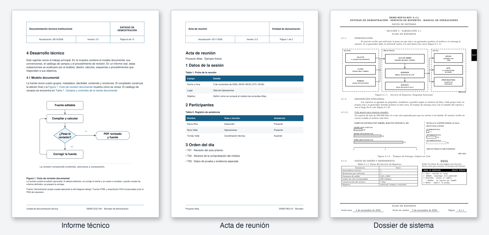

# Informe técnico institucional

Skill para crear informes técnicos, manuales de sistemas, catálogos de datos y actas institucionales a partir de fuentes del proyecto. La entidad, el logo y los colores se configuran para cada documento.

**Versión 0.6.0.** Incorpora el dossier de sistema y la exportación de actas de reunión a Word. Los tipos con motor JSON comparten la cabecera institucional, el pie y la paginación.

## Elige la plantilla

| Tipo | Cuándo usarlo | Qué necesitas aportar | JSON de partida y muestra |
| --- | --- | --- | --- |
| **Informe técnico** (`informe`) | Para explicar un sistema, documentar trabajo o presentar resultados. La estructura se adapta a manuales y catálogos. | Propósito, alcance y fuentes como código, documentación o evidencias. | [Plantilla base](skills/informe-tecnico/assets/plantilla-base.json) · [PDF de muestra](docs/muestra-perfil-apa.pdf) |
| **Acta de entrega y recepción** (`acta-entrega`) | Para dejar constancia de qué se entregó, a quién y con qué estado de recepción o conformidad. | Partes, fecha efectiva, inventario, versiones, comprobaciones y roles de firma. | [Ejemplo editable](skills/informe-tecnico/assets/ejemplo-acta-entrega.json) · [PDF de muestra](docs/muestra-acta-entrega.pdf) |
| **Acta de reunión** (`acta-reunion`) | Para dejar constancia de lo tratado y seguir las decisiones y compromisos de una sesión. | Fecha, participantes, agenda, notas de la reunión, responsables y plazos acordados. | [Ejemplo editable](skills/informe-tecnico/assets/ejemplo-acta-reunion.json) · [PDF de muestra](docs/muestra-acta-reunion.pdf) |
| **Dossier de sistema** (flujo `informe-dossier`) | Para presentar en 6 a 8 páginas cómo funciona un sistema y qué tan confiable es, con la conclusión primero y figuras en estilo de manual de operaciones del Apolo. | Una conclusión, de tres a cinco argumentos y las cifras que los sostienen, cada una con su fuente. Requiere el skill `nasa-handbook` de R44VC0RP instalado (versión probada: commit `e6f8682d1`). | No usa JSON. [Guía del dossier](skills/informe-tecnico/references/dossier.md) · [PDF de muestra](docs/muestra-dossier.pdf) |

El informe organiza el desarrollo técnico en el capítulo 4 y usa portada, historial e índices. Las actas empiezan con el contenido en la primera página y conservan el historial en la fuente editable. La de entrega separa la recepción de la conformidad. La de reunión conecta cada punto de la agenda con su resultado y, cuando corresponde, con el compromiso de seguimiento. [Guía de actas](skills/informe-tecnico/references/actas.md) El dossier no pasa por el motor JSON ni trae scripts: el agente lee `minto-pyramid`, `unicorntext`, `diagram-design` y las reglas de su guía, y arma las páginas con `nasa-handbook` en la versión congelada.

## Ejemplos de informes y manuales



| Muestra | Qué permite revisar | PDF y fuente |
| --- | --- | --- |
| Procedimientos y avisos | Perfil APA, pasos con resultados esperados, notas y precauciones, índice de procedimientos y pie alineado. | [PDF](docs/muestra-procedimientos-avisos.pdf) · [JSON](skills/informe-tecnico/assets/ejemplo-procedimientos.json) |
| Formato con criterios APA 7 | Sangrías, interlineado, cursivas, referencias y presentación de tablas y figuras. | [PDF](docs/muestra-perfil-apa.pdf) · [JSON](skills/informe-tecnico/assets/ejemplo-apa.json) |
| Perfil institucional original | Composición anterior y ejemplo de integración con diagram-design. Se conserva para comparar perfiles. | [PDF](docs/muestra-informe-tecnico.pdf) · [JSON](skills/informe-tecnico/assets/ejemplo.json) |
| Dossier de sistema | Portada con la pirámide y una subsección con diagrama funcional, gráficas de barras, tabla, aviso y tarjeta de procedimiento. Sistema ficticio. | [PDF](docs/muestra-dossier.pdf) (sin fuente JSON) |

## Qué resuelve

- Entidad, logo, colores, líneas y marco configurables.
- Cabecera con fecha de actualización, versión y «Página X de Y»; entidad y paginación comparten el mismo separador vertical.
- Historial de cambios con identificadores estables y referencias enlazadas.
- Contenido e índices de tablas, figuras y procedimientos calculados al compilar.
- Tablas multipágina con títulos y encabezados repetidos.
- Figuras con fuente editable, número, pie y destino en el índice.
- Comprobación estructural del PDF y pruebas de regresión del motor.
- Redacción de presentación adaptada a informes y manuales, con referencias por nombre o código documental. Las rutas personales y la trazabilidad de autoría quedan en archivos de trabajo.
- Perfil institucional con criterios APA 7: interlineado doble, sangría inicial, referencias con sangría francesa, cursivas y presentación de tablas y figuras.
- Procedimientos opcionales con acción y resultado esperado por paso, índice propio y avisos de nota, precaución o advertencia. [Criterios de uso](skills/informe-tecnico/references/procedimientos.md) y [ejemplo editable](skills/informe-tecnico/assets/ejemplo-procedimientos.json).

La muestra es ficticia. Los documentos institucionales que orientaron el diseño se describen en [fuentes](skills/informe-tecnico/references/fuentes.md); sus PDF y logos originales no forman parte del repositorio.

## Instalar en Codex

Pide al agente:

> Instala la skill informe-tecnico desde https://github.com/andresalmeida/informe-tecnico, ruta skills/informe-tecnico.

Para crear esquemas nuevos, añade la colaboradora:

> Instala diagram-design desde https://github.com/cathrynlavery/diagram-design, ruta skills/diagram-design.

El instalador de skills de Codex también admite estos comandos, ejecutados en un entorno con Python y acceso a GitHub:

```sh
python3 "${CODEX_HOME:-$HOME/.codex}/skills/.system/skill-installer/scripts/install-skill-from-github.py" \
  --repo andresalmeida/informe-tecnico --path skills/informe-tecnico

# Opcional, para crear esquemas nuevos:
python3 "${CODEX_HOME:-$HOME/.codex}/skills/.system/skill-installer/scripts/install-skill-from-github.py" \
  --repo cathrynlavery/diagram-design --path skills/diagram-design
```

Las skills instaladas estarán disponibles en el siguiente turno de Codex. Si ya existe una instalación, revisa las diferencias antes de actualizarla.

## Uso

Nombra el tipo de documento en tu solicitud y adjunta las fuentes. Si la entidad exige un formato oficial, adjúntalo también para que el agente trabaje sobre una copia. [Instrucciones de la skill](skills/informe-tecnico/SKILL.md)

Para un informe:

```text
Usa $informe-tecnico para preparar un informe sobre [tema] a partir de mis
archivos. Usa la identidad de [entidad] y coloca el trabajo principal en el
capítulo 4. Para los esquemas necesarios, aplica $diagram-design con los
mismos colores y tipografía.
```

Para un acta de entrega y recepción:

```text
Usa $informe-tecnico para preparar un acta de entrega y recepción de [objeto].
Adjunto el inventario y la evidencia de entrega. Identifica las partes, los
entregables, el estado de recepción y las comprobaciones pendientes.
```

Para un acta de reunión:

```text
Usa $informe-tecnico para preparar un acta de reunión a partir de estas notas.
Separa la agenda, el desarrollo por punto y los acuerdos. Registra los
responsables y plazos que consten e incorpora la próxima reunión y sus anexos.
```

Para un manual dentro de la estructura de informe:

```text
Usa $informe-tecnico para crear un manual de usuario por roles a partir de
este código, los manuales y las capturas. Incluye navegación y procedimientos
con resultados esperados. Usa la identidad de [entidad] y pide los datos
esenciales que falten para describir el funcionamiento real.
```

El motor PDF usa una fuente JSON editable y los activos del documento. El acta de reunión también se puede exportar como Word editable desde el mismo JSON. [Instrucciones de exportación a Word](skills/informe-tecnico/references/actas.md#acta-de-reunión-en-word)

La estructura base del informe comprende preliminares y siete capítulos:

1. Introducción.
2. Objetivos.
3. Alcance.
4. **Desarrollo técnico:** el trabajo principal, dividido en 4.1, 4.2, etc.
5. Resultados.
6. Conclusiones y recomendaciones.
7. Referencias.

Los módulos se adaptan al tipo de documento y a las estructuras institucionales que deban preservarse. Consulta la [guía de estructura](skills/informe-tecnico/references/estructura.md).

La [guía de redacción](skills/informe-tecnico/references/redaccion.md) distingue un informe de actividad, un manual y una evaluación solicitada. El documento describe el sistema y el trabajo realizado con lenguaje técnico; no narra cómo lo investigó el agente. Las comprobaciones y los pendientes conservan su estado real.

En resultados, conclusiones o resúmenes solicitados se presenta primero la respuesta sustentada y después sus razones y evidencia. La revisión editorial elimina repeticiones de relleno y conserva los términos técnicos, las listas útiles y las repeticiones necesarias para consultar una tarea por separado. Son criterios incorporados a la guía; Minto y unicorntext no se requieren como skills adicionales.

## Formato con criterios APA 7

La plantilla de informe parte de `format.profile: "institucional-apa"`, con cuerpo de 11 pt, interlineado 2,0, sangría inicial de 1,27 cm y referencias con sangría francesa de 1,27 cm. Los títulos de tabla y figura se colocan encima, con número en negrita y título en cursiva. Las tablas usan líneas horizontales mínimas y celdas con interlineado sencillo. Los ejemplos de actas usan el perfil `institucional` para una composición compacta.

Se conservan identidad, cabecera, portada, índices, márgenes institucionales y capítulos numerados. Es una adaptación para informes, no un formato académico APA integral. La [guía APA](skills/informe-tecnico/references/apa.md) identifica las diferencias y la atribución autor-fecha. Las fuentes antiguas sin `format` mantienen su composición; `profile: "institucional"` permite elegir expresamente el perfil original.

Los bloques `reference` y `quotation`, y los tramos `runs` para cursivas/negritas, están descritos en el [contrato](skills/informe-tecnico/references/contrato.md). El motor compone las entradas que se le suministran; la selección y verificación de autores, fechas y citas siguen siendo trabajo de autoría. La [guía APA](skills/informe-tecnico/references/apa.md) reúne los criterios y sus fuentes oficiales.

## Una skill coordina la otra

`informe-tecnico` y `diagram-design` se instalan por separado. El agente que aplica la principal carga la colaboradora cuando necesita crear un esquema:

| Paso | Responsable | Resultado |
| --- | --- | --- |
| Definir qué explicar y con qué evidencia | informe-tecnico | Propósito, datos, identidad y escala de impresión |
| Elegir representación y componer el esquema | diagram-design | HTML con SVG, validación y exportación estática |
| Integrar y comprobar el documento | informe-tecnico | Figura numerada, pie, referencias, índice y PDF revisado |

La integración es una instrucción de composición para el agente. El script `build_report.py` incorpora archivos terminados; no ejecuta otra skill ni instala dependencias automáticamente. La [guía de diagramas](skills/informe-tecnico/references/diagramas.md) define el flujo completo.

Para un informe que ya dispone de sus figuras, o que solo necesita texto y tablas, el motor PDF funciona sin diagram-design. Al cambiar de identidad gráfica, también se regeneran los esquemas externos desde su fuente editable.

## Ejecutar el motor sin el agente

Requiere Python 3.10 o posterior. Desde la raíz del repositorio:

```sh
python3 -m venv .venv
source .venv/bin/activate
python -m pip install -r requirements.txt

python skills/informe-tecnico/scripts/build_report.py \
  skills/informe-tecnico/assets/ejemplo-procedimientos.json \
  --output output/muestra.pdf

python skills/informe-tecnico/scripts/check_report.py output/muestra.pdf
python skills/informe-tecnico/scripts/self_test.py
```

El motor genera el PDF y un manifiesto de compilación. Para tu documento, copia el JSON de partida del tipo elegido, sustituye los datos de demostración, completa los campos obligatorios y conserva los activos junto a la fuente. Pasa esa copia como entrada a `build_report.py`. `document.kind` elige la estructura y `format.profile` el estilo. Las fuentes anteriores sin `document.kind` se leen como informes.

El ejemplo anterior compila un manual ficticio con procedimientos y avisos. La muestra del perfil original incluye además un esquema exportado a PNG y sus fuentes HTML/SVG editables. Integrar otros SVG directamente requiere el paquete opcional `svglib` y revisión de su compatibilidad. Crear o regenerar esquemas con diagram-design usa sus herramientas y requisitos propios.

## Comprobaciones y límites

Las pruebas comprueban continuación de tablas, desplazamiento de destinos al crecer el índice, conservación de números de catálogo, ceros iniciales, otro perfil gráfico/papel y rechazo de referencias desconocidas, IDs duplicados, filas excesivas y cabeceras desalineadas.

La regresión APA mide en el PDF la sangría de 36 pt y la distancia de 22 pt entre líneas, la sangría francesa y el bloque de cita, además de cursivas, título sobre la imagen y continuación de tablas. No certifica cumplimiento APA integral ni exactitud de las referencias.

Las pruebas de procedimientos comprueban navegación, continuidad entre páginas, posición del aviso antes de la acción y rechazo de pasos sin resultado esperado. Los avisos y resultados esperados no registran una ejecución de la aplicación ni una aprobación.

El motor PDF produce documentos A4 o Carta en vertical. El exportador Word cubre actas de reunión con perfil institucional. La revisión de las páginas renderizadas complementa las comprobaciones automáticas de composición.

## Licencia y atribuciones

[MIT](LICENSE). El scaffold del ejemplo de diagrama conserva la [licencia y atribución de diagram-design](skills/informe-tecnico/assets/diagrams/LICENSE-diagram-design.txt). Las referencias de diseño y las decisiones de adaptación se conservan en [fuentes.md](skills/informe-tecnico/references/fuentes.md). El flujo `informe-dossier` se apoya en el skill `nasa-handbook` de R44VC0RP, que no se copia aquí, y cita el decálogo de Prodigioso Volcán (`unicorntext`) y el Pyramid Principle de Barbara Minto.
