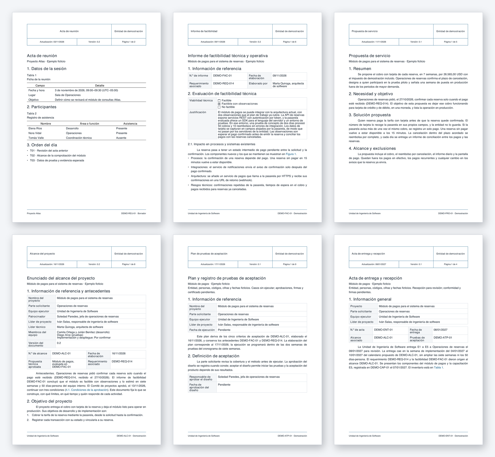

# Informe técnico institucional

Una skill para agentes (Claude Code, Codex, Cursor y otros) que redacta y compila en PDF documentos técnicos y de gestión de proyectos con la identidad de tu entidad: nombre, logo, colores y esquema de códigos. El agente lee `SKILL.md`, elige el tipo de documento, escribe una fuente JSON y un motor en Python la convierte en un PDF con cabecera, paginación, historial de cambios, índices y un comprobador.

**Versión 0.8.5** · licencia MIT · Python 3.10 o posterior

[](https://github.com/andresalmeida/informe-tecnico/actions/workflows/validate.yml)



<sub>Muestras con una entidad ficticia. Cada PDF completo está en [`docs/`](docs/).</sub>

## Qué produce

Veintidós tipos de documento y un dossier, ordenados por la fase del proyecto en la que se usan. Casi ningún proyecto los usa todos: los seis en **negrita** son el núcleo que cubre la mayoría. Cada nombre enlaza a su PDF de muestra.

| Fase | Documento | Para qué |
|---|---|---|
| **Levantamiento** | **[Acta de reunión](docs/muestra-acta-reunion.pdf)** | Dejar constancia de lo tratado y de los compromisos |
|  | [Registro de requerimientos](docs/muestra-registro-requerimientos.pdf) | Anotar un pedido recibido antes de evaluarlo |
| **Factibilidad** | **[Informe de factibilidad](docs/muestra-informe-factibilidad.pdf)** | Decidir si una propuesta técnica se puede asumir |
|  | [Registro de riesgos](docs/muestra-registro-riesgos.pdf) | Seguir los riesgos, con el nivel calculado desde una matriz |
|  | [Evaluación de impacto en datos](docs/muestra-evaluacion-impacto-datos.pdf) | Valorar qué datos personales se tratan y qué medidas los protegen |
| **Propuesta** | **[Propuesta de servicio](docs/muestra-propuesta-servicio.pdf)** | Ofrecer qué se hace, en qué plazo y por cuánto |
| **Arranque y planificación** | **[Alcance del proyecto](docs/muestra-alcance-proyecto.pdf)** | Fijar qué se construye y quién lo acepta |
|  | **[Plan de pruebas de aceptación](docs/muestra-plan-pruebas.pdf)** | Acordar los casos al arrancar y registrar los resultados en la validación |
|  | [Especificación de requisitos](docs/muestra-especificacion-requisitos.pdf) | Qué debe cumplir el sistema, cada requisito trazado a su origen y a su prueba |
|  | [Decisión de arquitectura](docs/muestra-decision-arquitectura.pdf) | Registrar una decisión con sus opciones y sus razones |
|  | [Descripción de arquitectura](docs/muestra-descripcion-arquitectura.pdf) | Las vistas del sistema para operarlo o extenderlo |
|  | [Plan de proyecto](docs/muestra-plan-proyecto.pdf) | Qué se entrega, en qué hitos y con qué esfuerzo |
|  | [Ficha de modelo](docs/muestra-ficha-modelo.pdf) | Acompañar un modelo estadístico o de aprendizaje automático |
| **Construcción** | [Solicitud de cambio](docs/muestra-solicitud-cambio.pdf) | Pedir un cambio sobre lo ya aprobado, con su impacto y la decisión |
| **Entrega y cierre** | **[Acta de entrega y recepción](docs/muestra-acta-entrega.pdf)** | Registrar qué se entregó y con qué conformidad |
|  | [Acta de capacitación](docs/muestra-acta-capacitacion.pdf) | Constancia de la capacitación a quienes usarán el sistema |
|  | [Traspaso a operación](docs/muestra-traspaso-operacion.pdf) | Quién opera, cómo se comprueba y cómo se vuelve atrás |
|  | [Informe de cierre](docs/muestra-informe-cierre.pdf) | Balance interno del proyecto |
| **Operación y evolución** | [Notas de versión](docs/muestra-notas-version.pdf) | Qué cambia en cada versión que se publica |
| **Retiro** | [Acta de baja](docs/muestra-acta-baja.pdf) | Retirar un sistema, un módulo o un procedimiento, con autorización |
| **Fuera del proyecto** | [Informe, manual o catálogo](docs/muestra-informe-tecnico.pdf) | Documentación técnica de un sistema, con citas y referencias APA 7 |
|  | [Ficha de proceso](docs/muestra-ficha-proceso.pdf) | Cómo trabaja un proceso de la entidad (SIPOC) |
|  | [Dossier de sistema](docs/muestra-dossier.pdf) | Cómo funciona un sistema y qué tan confiable es, en 6 a 8 páginas (flujo aparte, con la skill `nasa-handbook`) |

Todos comparten un mismo aspecto: cuerpo justificado con sangría en la primera línea, tablas con reglas mínimas, rótulos «Tabla 1» y «Figura 1» sobre cada objeto y títulos a la izquierda numerados («1. Título»). Con `format.profile: "institucional"` el documento sale en la composición compacta anterior.

Cada tipo tiene su guía en [`skills/informe-tecnico/references/tipos/`](skills/informe-tecnico/references/tipos/) y un JSON de partida en `assets/`. El [mapa de uso](skills/informe-tecnico/references/flujo-proyecto.md) explica además quién ve cada documento y cuándo se versiona.

## Cómo se usa

Instala la skill y pide el documento con tus palabras:

```text
Usa $informe-tecnico para preparar la propuesta de servicio del módulo de pagos
a partir de la factibilidad ya cerrada. Da el plazo, los entregables y la
cotización con mis precios, y deja la aceptación pendiente.
```

El agente elige el tipo con la tabla de `SKILL.md`, lee solo la guía de ese tipo, escribe el JSON, compila, comprueba y revisa cada página. Lo que no consta queda en «Pendiente», «Por confirmar» o «Por estimar»: no inventa firmas, aprobaciones ni cifras.

La identidad se configura en el JSON:

```json
"brand": { "entity": "Estudio de Software Ejemplo", "unit": "Equipo de Proyectos",
           "accent": "#2F4B7C", "logo": "logo.png" }
```

Cada guía incorpora dos criterios de escritura: la pirámide de Minto (la conclusión primero) y la revisión de estilo de unicorntext (sin relleno). Para los esquemas, la skill colaboradora `diagram-design` los dibuja con los colores y la tipografía del documento.

Los documentos de un proyecto forman una cadena: cada uno cita a los anteriores por su código (`SRO-ALC-01, versión 0.2`) y las versiones nuevas conservan el código.

## Instalar y actualizar

La versión instalada está en `metadata.version` de `SKILL.md` y debe coincidir con la de este README. Una copia antigua enruta un proyecto a un informe genérico. Para actualizar, guarda tus JSON fuera de la carpeta de la skill, bórrala y vuelve a instalar. Con el repositorio clonado, `python tools/instalar.py` hace todo eso por ti: instala la versión publicada en Claude Code y en Codex, deja un respaldo de la anterior y comprueba que las copias quedaron idénticas (`--simular` muestra lo que haría).

- **Claude Code.** Copia `skills/informe-tecnico` a `~/.claude/skills/informe-tecnico` (para todos tus proyectos) o a `.claude/skills/informe-tecnico` (para uno).
- **Codex.** Pide al agente: «Instala la skill informe-tecnico desde https://github.com/andresalmeida/informe-tecnico, ruta skills/informe-tecnico».
- **Esquemas nuevos (opcional).** La skill colaboradora [diagram-design](https://github.com/cathrynlavery/diagram-design) se instala por separado.

## Ejecutar el motor sin el agente

```sh
python3 -m venv .venv && source .venv/bin/activate
python -m pip install -r requirements.txt

python skills/informe-tecnico/scripts/build_report.py \
  skills/informe-tecnico/assets/ejemplo-acta-reunion.json --output output/acta.pdf
python skills/informe-tecnico/scripts/check_report.py output/acta.pdf
```

Copia el JSON de partida del tipo que necesites, cambia los datos de demostración y conserva los activos junto a la fuente. El acta de reunión también se exporta a Word. Si falta una dependencia, el script termina con un mensaje que dice qué instalar.

Para modificar el motor o añadir un tipo: `python tests/self_test.py` ejecuta las pruebas, [docs/nuevo-tipo.md](docs/nuevo-tipo.md) explica los pasos y [CONTRIBUTING.md](CONTRIBUTING.md) describe las ramas.

## Qué hay en el repositorio

```text
skills/informe-tecnico/   la skill que se instala
  SKILL.md                lo que lee el agente: elige el tipo y enruta
  references/             guías por tipo (tipos/), del informe (informe/) y comunes
  assets/                 JSON de partida de cada tipo
  scripts/                el motor: compila el PDF y lo comprueba
tests/                    pruebas del motor
tools/                    regresión entre versiones
docs/                     muestras en PDF y guía para añadir un tipo
```

Este README es para quien llega al repositorio. El agente que usa la skill lee `SKILL.md` y las guías; quien la mantiene, sea una persona o un agente, lee [AGENTS.md](AGENTS.md) y [CONTRIBUTING.md](CONTRIBUTING.md).

## Lo que esta skill no hace

- **No da asesoría legal ni contable.** Los campos normativos de la evaluación de impacto en datos quedan «Por confirmar con asesoría legal», y las condiciones de pago, garantía y validez de una propuesta las escribe la entidad.
- **No firma.** Las firmas del PDF son espacios para firmar; el motor no implementa firma electrónica. Una aceptación comunicada no es una firma.
- **No acredita.** El certificado del plan de pruebas registra una decisión entre las partes, no la certificación de un tercero.
- **No garantiza la composición.** El comprobador revisa lo que puede medir; abrir todas las páginas renderizadas sigue siendo parte del trabajo.

## Licencia y atribuciones

[MIT](LICENSE). Las referencias de diseño y las decisiones de adaptación están en [fuentes.md](skills/informe-tecnico/references/fuentes.md). El ejemplo de diagrama conserva la [licencia de diagram-design](skills/informe-tecnico/assets/diagrams/LICENSE-diagram-design.txt). El dossier se apoya en el skill `nasa-handbook` de R44VC0RP, que no se copia aquí, y cita el decálogo de Prodigioso Volcán (`unicorntext`) y el Pyramid Principle de Barbara Minto.
